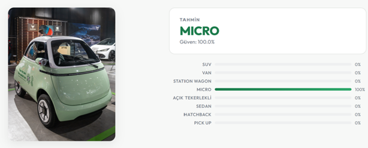
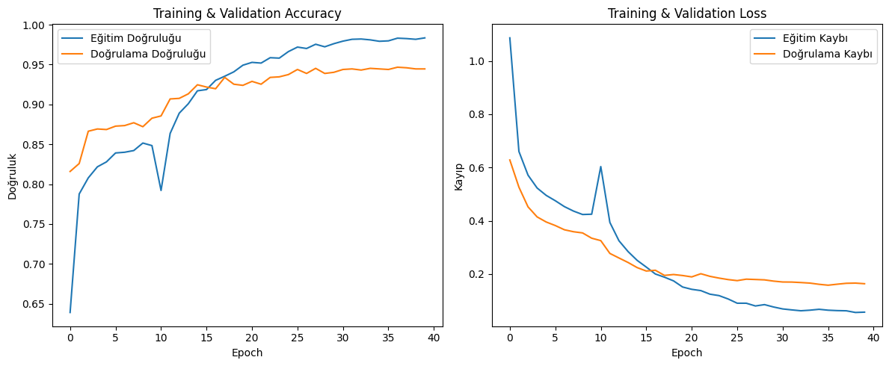

# 🚗 AutoScan: Car Body Type Classification

A deep learning model that classifies vehicle images into **8 body types** using transfer learning on EfficientNetB0, served through a web application for real-time predictions.

> Kocaeli University, Department of Computer Engineering, Software Laboratory II, Project III



---

## 📌 Table of Contents

- [About the Project](#-about-the-project)
- [Results](#-results)
- [Dataset](#-dataset)
- [Model Architecture](#-model-architecture)
- [Training Strategy](#-training-strategy)
- [Web Application](#-web-application)
- [Installation and Usage](#-installation-and-usage)
- [Project Structure](#-project-structure)
- [Limitations and Future Work](#-limitations-and-future-work)

---

## 🔍 About the Project

Vehicle recognition is a key component in many real-world applications such as smart traffic management, autonomous driving, parking management, insurance and security systems. This project develops a system that automatically predicts a vehicle's body type from a single photo.

**Classes:**

| # | Class | # | Class |
|---|-------|---|-------|
| 1 | SUV | 5 | Open-Wheel (F1) |
| 2 | VAN | 6 | Sedan |
| 3 | Station Wagon | 7 | Hatchback |
| 4 | Micro | 8 | Pick Up |

**Tech stack:**

| Layer | Technology |
|-------|------------|
| Model | TensorFlow / Keras, EfficientNetB0 (ImageNet weights) |
| Training environment | Google Colab (T4 GPU) |
| Evaluation | scikit-learn, Seaborn, Matplotlib |
| Backend | Python, FastAPI, Uvicorn, Pillow |
| Frontend | Next.js, React, TypeScript |

---

## 📊 Results

### Validation set (1,407 images)

| Metric | Value |
|--------|-------|
| Accuracy | **94.67%** |
| Macro F1 | 0.9469 |
| Macro Precision | 0.9470 |
| Macro Recall | 0.9472 |

| Class | Precision | Recall | F1 | Support |
|-------|-----------|--------|----|---------|
| SUV | 0.95 | 0.93 | 0.94 | 158 |
| VAN | 0.99 | 1.00 | 0.99 | 162 |
| Station Wagon | 0.89 | 0.86 | 0.87 | 173 |
| Micro | 1.00 | 0.96 | 0.98 | 213 |
| Open-Wheel (F1) | 0.99 | 0.99 | 0.99 | 157 |
| Sedan | 0.88 | 0.89 | 0.89 | 188 |
| Hatchback | 0.89 | 0.95 | 0.92 | 171 |
| Pick Up | 0.99 | 0.99 | 0.99 | 185 |

### Training curves

Combined accuracy and loss curves of the two-stage training (first 10 epochs: frozen base model, afterwards: fine-tuning):

<p align="center">
  
</p>

The temporary drop in training accuracy and the spike in loss around epoch 11 reflect the network adapting after the last 30 layers were unfrozen for fine-tuning. The model then recovers and keeps improving validation accuracy steadily.

VAN, Open-Wheel and Pick Up are classified almost perfectly thanks to their distinctive visual features (tall boxy body, open cockpit, open cargo bed). Most confusion occurs between **Station Wagon, Sedan and Hatchback**, which share similar body lines, roof slopes and rear sections.

### Out-of-domain test set (80 images, 10 per class)

To measure real-world generalization, a separate test set was collected from sources independent of the training data.

| Class | Precision | Recall | F1 |
|-------|-----------|--------|----|
| SUV | 0.71 | 0.50 | 0.59 |
| VAN | 1.00 | 1.00 | 1.00 |
| Station Wagon | 1.00 | 0.50 | 0.67 |
| Micro | 1.00 | 0.90 | 0.95 |
| Open-Wheel (F1) | 1.00 | 1.00 | 1.00 |
| Sedan | 0.40 | 0.20 | 0.27 |
| Hatchback | 0.45 | 1.00 | 0.63 |
| Pick Up | 0.75 | 0.90 | 0.82 |
| **Macro Avg.** | **0.79** | **0.75** | **0.74** |

Overall accuracy is **75%**. The gap from the 94.67% validation accuracy points to **data leakage** caused by the random split (`validation_split=0.2`): photos of the same car taken from different angles can end up in both the training and validation sets. The 75% result should therefore be considered a closer estimate of real-world performance. A car-based split is proposed as a fix (see [Future Work](#-limitations-and-future-work)).

---

## 🗂 Dataset

> ⚠️ **The dataset is not included in this repository due to its size and licensing terms.** Below is a description of where and how the data was collected, and how to rebuild it.

**7,039 images** in total across 8 classes. Around **880 images per class** were targeted to keep the classes balanced, and this target was largely met.

### Sources

| Source | Classes | Description |
|--------|---------|-------------|
| [Stanford Car Body Type Data](https://www.kaggle.com/datasets/mayurmahurkar/stanford-car-body-type-data) (Kaggle) | Sedan, SUV, Hatchback, Station Wagon, VAN, Pick Up | Derived from the Stanford Cars dataset, labeled by body type based on car model names |
| [Cars Body Type Cropped](https://www.kaggle.com/datasets/ademboukhris/cars-body-type-cropped) (Kaggle) | Mainly SUV, Sedan, Hatchback | Cropped vehicle images labeled by body type; used to reinforce these classes |
| [F1 Image Classification](https://www.kaggle.com/datasets/loveymishra/f1-image-classification-updated) (Kaggle) | Open-Wheel (F1) | Images from various teams, seasons and tracks; randomly sampled for diversity |
| [Wikimedia Commons](https://commons.wikimedia.org) (web scraping) | Micro, Station Wagon | Collected automatically with Python because the Kaggle datasets did not provide enough images |

For the **Micro** class, photos of models such as the Smart Fortwo, Renault Twizy, Citroën Ami, Fiat Topolino and Yoyo XEV were scraped from Wikimedia Commons. The **Station Wagon** class was completed by combining the Stanford data with Wikimedia scraping.

The dataset covers different lighting conditions, camera angles (front, side, rear, 3/4) and backgrounds (studio, outdoor, urban).

### Data cleaning

- Images showing the car interior, containing multiple different vehicles, or with very low resolution or heavy noise were removed **manually**.
- Corrupted or unreadable files were detected and deleted automatically using **PIL (Pillow)**.

### Rebuilding the dataset

1. Download the Kaggle datasets listed above.
2. Copy the images of the relevant classes into the folder structure below (aim for ~880 images per class).
3. Collect additional images for the Micro and Station Wagon classes from Wikimedia Commons.
4. Apply the cleaning steps.

```
dataset/
├── SUV/
├── VAN/
├── STATION WAGON/
├── MICRO/
├── AÇIK TEKERLEKLİ/      # Open-Wheel (F1)
├── SEDAN/
├── HATCHBACK/
└── PICK UP/
```

> Folder names must exactly match the class names used in the code.

### Train / validation split

The data was split using `tf.keras.utils.image_dataset_from_directory` with `validation_split=0.2` and `seed=42` for reproducibility:

| Set | Images |
|-----|--------|
| Training (80%) | 5,632 |
| Validation (20%) | 1,407 |

---

## 🧠 Model Architecture

```
Input (224 × 224 × 3)
   │
EfficientNetB0 (ImageNet, include_top=False)   →  7 × 7 × 1280
   │
GlobalAveragePooling2D                         →  1280
   │
Dropout (0.3)
   │
Dense (8, softmax)
```

- **EfficientNetB0** is designed with *compound scaling*, which scales network depth, width and resolution together, providing high accuracy at low computational cost.
- Total parameters: **4,059,819** (trainable in stage 1: 10,248)
- Model size: **27.8 MB** (well below the project's 95 MB limit)

### Preprocessing and data augmentation

All images are resized to 224 × 224 and normalized with EfficientNet's `preprocess_input`. The following augmentations are applied **to the training set only**:

| Technique | Parameter | Purpose |
|-----------|-----------|---------|
| RandomFlip | horizontal | Cars can be seen from either side |
| RandomRotation | ±0.1 | Different camera tilts |
| RandomZoom | ±10% | Different shooting distances |
| RandomBrightness | ±0.1 | Different lighting conditions |
| RandomContrast | ±0.1 | Different camera settings |

The input pipeline is optimized with `tf.data.AUTOTUNE` and prefetching.

---

## 🏋️ Training Strategy

A two-stage transfer learning approach was used.

| Parameter | Stage 1 | Stage 2 (Fine-tuning) |
|-----------|---------|-----------------------|
| Base model | Fully frozen | Last 30 / 238 layers unfrozen |
| Learning rate | 1e-3 | 1e-4 |
| Max epochs | 10 | 30 |
| EarlyStopping patience | 5 | 7 |
| Best val. accuracy | 88.27% | **94.67%** (epoch 27) |

**Shared settings:** Adam optimizer, categorical cross-entropy, batch size 32.

**Callbacks:**
- `ModelCheckpoint`: saves the model in `.keras` format whenever `val_accuracy` improves.
- `EarlyStopping`: restores the best weights with `restore_best_weights=True`.
- `ReduceLROnPlateau`: multiplies the LR by 0.3 if validation loss does not improve for 3 epochs (min 1e-7). In stage 2, the LR was reduced to 3e-5 at epoch 19 and to 9e-6 at epoch 29.

Reaching 81.6% validation accuracy after the very first epoch shows the strength of the transfer from ImageNet weights.

---

## 🌐 Web Application

The frontend and backend are two independent layers that communicate over a REST API.

```
┌───────────────────────┐   POST /predict   ┌──────────────────────────┐
│  Next.js (TypeScript) │ ────────────────► │  FastAPI (Python)        │
│  localhost:3000       │ ◄──────────────── │  localhost:8000          │
└───────────────────────┘   JSON response   │  autoscan_model.keras    │
                                            └──────────────────────────┘
```

### Backend

1. The image is sent to the `/predict` endpoint as `multipart/form-data`.
2. It is converted to RGB and resized to 224 × 224 with Pillow.
3. It is normalized with `preprocess_input`.
4. The model, loaded into memory **once** at startup, runs the prediction.
5. Probabilities for all 8 classes are returned as JSON.

Average prediction time is around **0.5–1 second**.

### Frontend pages

| Page | Description |
|------|-------------|
| **Classify** | Image upload, preview, scan animation, predicted class, confidence score and a probability bar chart for all classes |
| **Performance** | Accuracy/loss curves, confusion matrix, per-class metrics |
| **History** | List of past predictions (stored in `localStorage`) |
| **About** | Information about the project, model, dataset and training |

---

## ⚙️ Installation and Usage

### Requirements

- Python 3.10+
- Node.js 18+

### 1. Clone the repository

```bash
git clone https://github.com/ipekagan/AutoScan.git
cd AutoScan
```

### 2. Download the trained model

The model file (`autoscan_model.keras`, 27.8 MB) is not included in the repository due to GitHub's file size limit.

1. Download the model from this link: **[autoscan_model.keras (Google Drive)](https://drive.google.com/file/d/1DjQ1JX5c-Sy87SUtaNJE1cBSALkf6dWU/view?usp=sharing)**
2. Place the downloaded file in the `backend/` folder, next to `main.py`.
3. Make sure the file is named exactly `autoscan_model.keras`; the backend looks for this name.

Correct location:

```
AutoScan/
└── backend/
    ├── main.py
    ├── autoscan_model.keras   ← here
    └── requirements.txt
```

> If the model cannot be found, the backend will fail on startup.

### 3. Backend

```bash
cd backend
python -m venv venv

# Windows
venv\Scripts\activate
# macOS / Linux
source venv/bin/activate

pip install -r requirements.txt
uvicorn main:app --reload --port 8000
```

API documentation: http://localhost:8000/docs

### 4. Frontend

In a new terminal:

```bash
cd frontend
npm install
npm run dev
```

App: http://localhost:3000

### Example API request

```bash
curl -X POST "http://localhost:8000/predict" -F "file=@sample_car.jpg"
```

Example response:

```json
{
  "class": "MICRO",
  "class_id": 4,
  "confidence": 0.9998,
  "probabilities": {
    "SUV": 0.0000,
    "VAN": 0.0000,
    "STATION WAGON": 0.0000,
    "MICRO": 0.9998,
    "AÇIK TEKERLEKLİ": 0.0000,
    "SEDAN": 0.0001,
    "HATCHBACK": 0.0001,
    "PICK UP": 0.0000
  }
}
```

| Endpoint | Method | Description |
|----------|--------|-------------|
| `/predict` | POST | Accepts an image and returns the predicted body type and probabilities for all 8 classes |
| `/health` | GET | Checks whether the server is running |

### Retraining the model

Open the notebook in the `notebooks/` folder in Google Colab, prepare the dataset as described above, upload it to Google Drive and run the cells in order.

---

## 📁 Project Structure

```
AutoScan/
├── backend/                     # FastAPI server
│   ├── main.py                  # /predict and /health endpoints
│   ├── autoscan_model.keras     # Trained model (download from Drive, not in repo)
│   └── requirements.txt
├── frontend/                    # Next.js (TypeScript) interface
│   ├── app/
│   │   ├── predict/page.tsx
│   │   ├── performance/page.tsx
│   │   ├── history/page.tsx
│   │   ├── about/page.tsx
│   │   └── globals.css
│   ├── public/                  # Charts and UI images
│   └── package.json
├── notebooks/
│   └── egitim.ipynb             # Model training and evaluation (Colab)
└── README.md
```

---

## 🚧 Limitations and Future Work

**Limitations**
- Station Wagon, Sedan and Hatchback are often confused due to similar body lines and roof slopes. In the out-of-domain test, most Sedan images were predicted as Hatchback.
- Because of the random split, validation accuracy overestimates real-world performance.
- Background and shooting-condition diversity is limited for some classes.

**Future work**
- Car-based split: assigning all images of the same car to either the training or the validation set only
- Expanding the dataset for the frequently confused classes
- Trying larger variants such as EfficientNetB1/B2
- Adding vehicle segmentation to reduce background influence

---


## 👩‍💻 Author

**Nazire İpek Agan**
Kocaeli University, Computer Engineering
